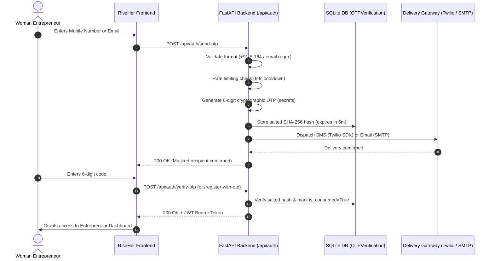

# RiseHer – System Architecture & Implementation

## 1. System Overview

RiseHer is an integrated, full-stack decision-support and ecosystem platform designed to empower women entrepreneurs across India. The architecture combines:
- **Frontend**: Single-Page Application (SPA) built with React 18, TypeScript, Vite, and Tailwind CSS.
- **Backend API**: High-performance RESTful API powered by FastAPI, Pydantic v2, and SQLAlchemy.
- **Database**: SQLite embedded engine (`riseher.db`) with full transactional integrity and migrations.
- **Intelligence Engine**: Explainable business feasibility scoring, risk matrices, and official NITI Aayog WEP scheme matching algorithms.
- **Security & Delivery Gateway**: Cryptographic salted SHA-256 OTP verification supporting live carrier SMS (Twilio SDK) and live email delivery (SMTP / Resend / SendGrid / Dev Mode).

---

## 2. Directory Structure

```text
risher/
├── frontend/                     # React 18 + TypeScript + Vite SPA
│   ├── public/
│   │   ├── images/entrepreneurs/ # Verified high-res portraits of women founders
│   │   └── favicon.svg
│   ├── src/
│   │   ├── components/           # Reusable UI elements & navigation
│   │   ├── views/                # Full-screen pages (Auth, Dashboard, Analysis, Schemes)
│   │   ├── types.ts              # TypeScript domain schemas
│   │   ├── api.ts                # Centralized typed HTTP API client
│   │   ├── main.tsx              # Application entrypoint
│   │   └── index.css             # Tailwind base styles & color tokens
│   ├── package.json
│   ├── tsconfig.json
│   └── vite.config.ts
│
├── backend/                      # FastAPI Python Application
│   ├── routers/                  # Modular route controllers
│   │   ├── auth.py               # Authentication & OTP flows
│   │   ├── profile.py            # Entrepreneur profile CRUD & AI refresh
│   │   ├── analysis.py           # Business feasibility & unit economics
│   │   ├── schemes.py            # Government scheme matching & eligibility
│   │   ├── risk.py               # Business risk matrix & mitigation
│   │   ├── mentors.py            # Experienced mentor connections
│   │   └── business_plan.py      # AI business plan generator
│   ├── config.py                 # Twelve-factor environment loader & credentials
│   ├── database.py               # SQLAlchemy engine & session maker
│   ├── models.py                 # ORM models (User, Profile, Schemes, OTPs)
│   ├── schemas.py                # Pydantic validation schemas
│   ├── delivery_service.py       # Live Twilio SMS & SMTP email dispatcher
│   ├── ai_engine.py              # Feasibility, risk & scheme intelligence
│   ├── seed_data.py              # Official seed database generator
│   ├── main.py                   # FastAPI server entrypoint
│   ├── requirements.txt
│   └── .env.example
│
├── tests/                        # Comprehensive Pytest Verification Suite
│   ├── test_twilio_sms_integration.py
│   ├── test_email_smtp_integration.py
│   ├── test_mandatory_otp_and_real_delivery.py
│   ├── test_otp_and_profile_refresh.py
│   └── test_riseher_workflow.py
│
├── docs/                         # Architecture & platform documentation
│   └── ARCHITECTURE.md
│
├── .gitignore                    # Comprehensive secrets & cache exclusion
├── .env.example                  # Environment configuration template
├── README.md                     # Complete project documentation & setup
├── requirements.txt              # Unified Python dependency specification
└── run_riseher.sh                # Single-command local startup script
```

---

## 3. Authentication & OTP Verification Flow



---

## 4. Security Highlights

1. **No Plaintext Tokens**: OTPs are salted and hashed with SHA-256 before persistence.
2. **Brute-Force Protection**: 5-attempt lockout per OTP challenge.
3. **Replay Immunity**: Challenges are marked `is_consumed = True` immediately upon successful verification.
4. **Environment Isolation**: Live secrets (`TWILIO_AUTH_TOKEN`, `EMAIL_PASSWORD`, `SECRET_KEY`) are loaded dynamically and strictly excluded from version control via `.gitignore`.
